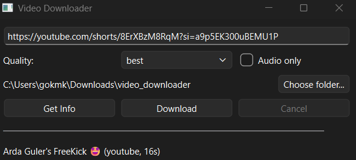

# Video Downloader

Reliable, user-friendly video downloading application. Give it a URL, it downloads the video/media.
Built so additional platforms and UIs can be added later without a major rewrite.



## Architecture

Layered design, core decoupled from any specific UI:

```
cli/        Typer CLI — thin adapter over core.service, no business logic
web/        FastAPI web UI — same relationship to core.service, just over HTTP/SSE instead of a terminal
gui/        PySide6 desktop app — same relationship again, over Qt signals instead of stdout
core/       DownloadService (public API), domain models, ports (Protocol interfaces), errors, retry policy
adapters/   YtDlpAdapter — the only place yt-dlp is imported; translates yt-dlp exceptions to core.errors
media/      filename sanitization and collision-safe naming
config/     AppConfig
utils/      disk space checks, logging setup
```

`core/ports.py` defines `MediaProbe`/`MediaDownloader` as `Protocol`s so a non-yt-dlp platform handler
could be added later without changing `core/service.py`. `cli/`, `web/`, and `gui/` are three independent
UIs over the same `core.service.DownloadService` — none of them touch `adapters/` directly except to
construct a `YtDlpAdapter` once at startup and hand it to the service.

## Setup

```powershell
cd video_downloader
python -m venv .venv
.\.venv\Scripts\python.exe -m pip install --upgrade pip
.\.venv\Scripts\python.exe -m pip install -e ".[dev]"
```

Requires `ffmpeg` on PATH (used by yt-dlp to merge/convert streams) — not bundled with this project.

## Usage

```powershell
.\.venv\Scripts\python.exe -m video_downloader download <URL>
.\.venv\Scripts\python.exe -m video_downloader info <URL>
```

### Sites that require sign-in (Instagram and others)

Many platforms — Instagram in particular — refuse to serve most content to yt-dlp unless it looks like
a logged-in browser. If `download`/`info` fails with "This content requires an authenticated session",
pass your own browser's session cookies through:

```powershell
.\.venv\Scripts\python.exe -m video_downloader download <URL> --cookies-from-browser chrome
# or, from an exported cookies.txt (recommended on Windows, see note below):
.\.venv\Scripts\python.exe -m video_downloader download <URL> --cookies-file C:\path\to\cookies.txt
```

`--cookies-from-browser` accepts any browser yt-dlp supports (`chrome`, `firefox`, `edge`, `brave`, ...).
On Windows, two things commonly go wrong with it:
- The browser (including background/tray processes, not just the window) must be fully closed for
  yt-dlp to read its cookie database — otherwise it fails with "Could not copy ... cookie database".
- Recent Chrome/Edge versions encrypt cookies with extra OS-level protection ("App-Bound Encryption")
  that yt-dlp cannot always decrypt even with the browser closed ("Failed to decrypt with DPAPI").

If you hit the DPAPI error, **use `--cookies-file` instead** — export a `cookies.txt` with a browser
extension (e.g. "Get cookies.txt LOCALLY") while logged in, then pass that file. It reads already
decrypted cookie values from the browser itself, so it isn't affected by either issue above.

Both flags can also be set once via environment variables (`VIDEO_DOWNLOADER_COOKIES_FROM_BROWSER`,
`VIDEO_DOWNLOADER_COOKIES_FILE`) instead of passing them on every command. Only use this with your own
account/session for content you're already allowed to view when logged in.

Add `--debug` to any command to see yt-dlp's raw diagnostic output and a full traceback instead of the
short, translated error message.

## Web UI

```powershell
.\.venv\Scripts\python.exe -m pip install -e ".[dev,web]"
.\.venv\Scripts\python.exe -m uvicorn video_downloader.web.main:app --host 127.0.0.1 --port 8000
```

Open `http://127.0.0.1:8000` for a minimal page (URL, quality, audio-only, live progress via SSE).
Binds to `127.0.0.1` only by default — this endpoint fetches a server-supplied URL, so exposing it beyond
localhost (`--host 0.0.0.0`) needs its own auth in front of it; `web/security.py` already rejects URLs
that resolve to private/loopback/link-local addresses (SSRF protection), but that's not the same as auth.
Job state is in-memory only — a server restart loses in-progress/queued jobs (no database in v1).

Endpoints: `GET /media-info?url=...`, `POST /downloads`, `GET /downloads/{id}`,
`POST /downloads/{id}/cancel`, `GET /downloads/{id}/events` (SSE).

## Windows Desktop App

```powershell
.\.venv\Scripts\python.exe -m pip install -e ".[dev,gui]"
.\.venv\Scripts\python.exe -m video_downloader.gui.main
```

URL field, quality/audio-only options, an output-folder picker, a progress bar fed by the same
`ProgressEvent`s the CLI uses, and Download/Cancel. Downloading and probing both run on a background
`QThread` so the window never freezes.

To build a standalone `.exe` (no Python install required to run it):

```powershell
.\.venv\Scripts\python.exe -m pip install pyinstaller
.\.venv\Scripts\python.exe -m PyInstaller video-downloader-gui.spec
```

Output is `dist\video-downloader-gui.exe` (~55MB, one file). `ffmpeg` is still a runtime prerequisite —
not bundled into the `.exe` — so it must be on `PATH` wherever the `.exe` runs.

## Tests

```powershell
.\.venv\Scripts\python.exe -m pytest
```

Tests marked `live` hit real network/yt-dlp and are excluded by default (`pytest -m live` to run them).
`tests/web/` and `tests/gui/` need the `web`/`gui` extras installed to collect.
